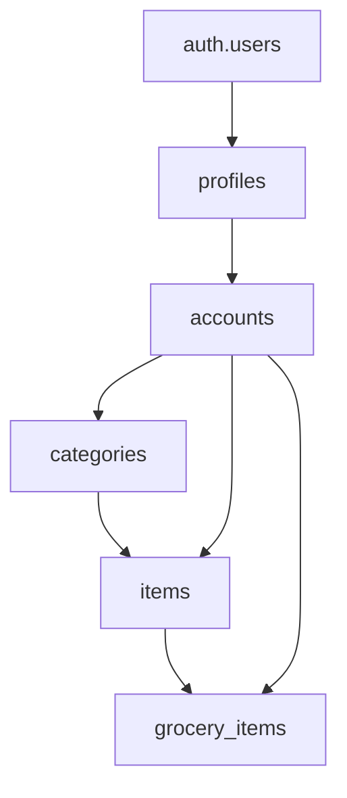
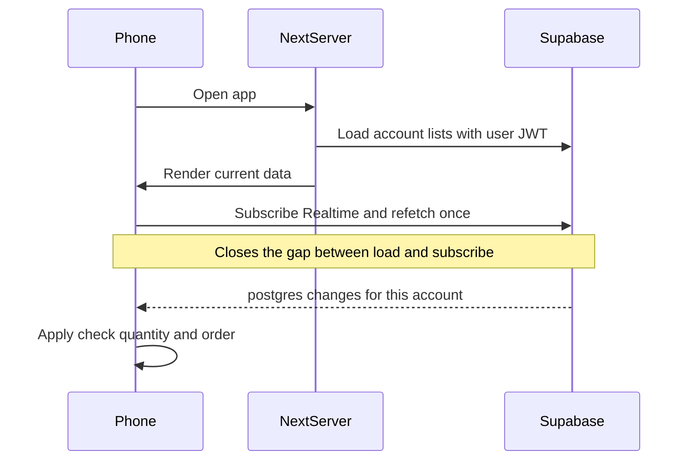

# CnaanList on Next.js and Supabase

Build a mobile-first, Hebrew RTL Next.js app (CnaanList) with one account per login: an inventory and a grocery list stored in Supabase, username login, persistent sessions, and live updates across every device signed into that same account.

Greenfield app in this empty workspace. Each login owns one account. The account has one inventory and one grocery list, both empty at creation. There is no invite and no shared access between different logins. Several people can sign in with the same username and password at the same time, on different devices, and each session shows the same lists.

## Stack

- Next.js App Router, TypeScript, Tailwind CSS, React Server Components for the first load and client components for interaction
- `@supabase/supabase-js` and `@supabase/ssr` (cookie session, refreshed in middleware)
- `@dnd-kit` for touch-friendly reorder (drag handle, so the page can still scroll)
- Rubik via `next/font`, `<html lang="he" dir="rtl">`, Tailwind logical properties (`ps`/`pe`, `text-start`) so layout stays correct in RTL
- Mobile-first UI that follows the attached mockups. Cream page, white cards, gray grocery category bars, teal save button. Fixed bottom nav, safe-area padding. Visual order left to right: רשימת מוצרים, רשימת קניות, הגדרות. The active tab is black; the others are gray.

Env vars only (no keys in the repo):

- `NEXT_PUBLIC_SUPABASE_URL`
- `NEXT_PUBLIC_SUPABASE_ANON_KEY`
- `SUPABASE_SERVICE_ROLE_KEY` (server only: resolve username to email at login and password reset)

## Data model

Tables in [`supabase/migrations/0001_init.sql`](../supabase/migrations/0001_init.sql):

- `profiles`: `id` = `auth.users.id`, unique `username` (case-insensitive), `email`
- `accounts`: `id`, `owner_id` unique, so one account per login
- `categories`: `account_id`, `name`, `color`, `image_path`, `sort_order`
- `items`: `account_id`, `category_id`, `name`, `unit`, `comments`, `image_path`, `quantity`, `sort_order`
- `grocery_items`: `account_id`, `item_id` (unique per account), `checked`

Units are stable keys (`unit`, `kg`, `g`, `l`, `ml`, `pack`, `box`, `bag`, `bottle`) with Hebrew labels in the UI (יחידה, ק״ג, גרם, ליטר, מ״ל, חבילה, קופסה, שקית, בקבוק).

Quantity lives on the item. The grocery stepper and the details sheet edit that same value. A grocery line only records that the item is on the list and whether it is checked.

Grocery order is **not stored**. Both lists use `sort_order`. Checking an item sets `checked = true` and does not change its category. The grocery screen paints checked rows under בעגלת הקניות. Tapping a cart row clears the flag so it returns to its category.

Signup trigger (security definer): create `profiles` from `raw_user_meta_data.username`, then an `accounts` row owned by that profile. No seed categories.

RLS: every read/write on categories, items, and grocery lines is allowed only when the account’s `owner_id` is `auth.uid()`. Profiles: a user can read and update only their own row. There is no membership table and no path from one login to another login’s rows.

Storage bucket `item-images` (private). Paths `{account_id}/items/{item_id}/{file}.webp` and `{account_id}/categories/{category_id}/{file}.webp`. Storage policies allow access only for the account owner. The browser compresses uploads (max edge ~1200px, webp/jpeg) before upload. Display uses signed URLs.

Realtime enabled on `categories`, `items`, and `grocery_items`.

Indexes: `(account_id, sort_order)` on categories, `(account_id, category_id, sort_order)` on items, unique `(account_id, item_id)` on grocery lines.

Reorder RPCs `reorder_categories(ids)` and `reorder_items(category_id, ids)` update `sort_order` in one transaction. Both check that the caller owns the account.

## Auth

Username + email + password. People log in with **username**. Email is for confirmation and password reset.

- Signup asks for username, email, password. Username: 3–24 chars, Hebrew or Latin letters, digits, underscore. Pass `username` in signup metadata.
- Login is a server action. It resolves username to email with the service role, then `signInWithPassword`, and writes the Supabase cookies. The email is never returned to the browser. Wrong username and wrong password share one message: פרטי ההתחברות שגויים.
- Session cookies are httpOnly, `SameSite=Lax`, refreshed in [`middleware.ts`](../middleware.ts). This is the “remember me” behavior: the refresh token keeps them signed in until logout. Supabase rotates refresh tokens.
- Logout calls `signOut` with local scope and stays on הגדרות, now showing the login form. That ends this browser only. Other devices signed into the same account stay signed in.
- Supabase already allows more than one session per login. Do not cap sessions to one, and do not revoke other sessions on login or logout. Anyone who knows the username and password can connect; a different username is a different account and cannot see these lists.
- Forgot password: username or email. Server sends Supabase’s reset mail and always shows the same “if the account exists, we sent a mail” response.
- Dashboard settings to turn on (documented in the README, not code): confirm email, minimum password length, leaked-password protection. Redirect URLs for `/auth/callback` and `/auth/reset`.

## Visual design

Match the four mockups. Hebrew, `dir="rtl"`, but place chrome where the pictures place it: search on the left edge, title centered, actions on the right edge, bottom nav left to right as מוצרים, קניות, הגדרות.

Shared chrome:

- Left: magnifying glass
- Center: screen title
- Right: plus, sort, reorder (the sliders icon in the mock)
- Page background cream, content inset from the edges
- Bottom nav fixed, white, three tabs with icons: cubes for רשימת מוצרים, list for רשימת קניות, gear for הגדרות
- On הגדרות the four header controls are visible, as in the mock, and inactive

**רשימת הקניות**

- Category name is a light gray bar, centered. Each row under it has that category’s color as a thin stripe on the right edge.
- An active grocery row is a white card: dot button on the left, then minus, quantity plus the unit label (the mock shows `2 יח`), plus, item name, circular photo, color stripe on the far right.
- After the categories, a gray bar titled בעגלת הקניות. Those rows have the dot button, name, photo, and the item’s category stripe. They do not show the stepper.
- Only categories that contain a grocery line are shown. Order follows `sort_order`.

**רשימת המוצרים**

- A category is a white card: dot button, category name, circular image, color stripe. Stripe color is chosen per category (the mock uses blue, orange, and green).
- Tapping the category card body expands or collapses it. An open category shows a full-width “הוספת מוצר חדש” row in orange with a plus on the right, then its products. A collapsed category is only the card, which is why קטגוריה א and קטגוריה ג have no products under them while קטגוריה ב does.
- A product card: dot button, name, circular photo or a picture placeholder, and the parent category’s stripe. No stepper on this list.

**Details sheet**

Bottom sheet over the list. The dot button opens it. For a product, fields top to bottom:

- Name, with a clear button
- Quantity as amount plus unit (the mock shows `1 kg`) with a pen, then minus and plus; beside it a unit menu (the mock shows קג)
- Category menu
- Circular image, plus a button to set or replace the image
- Comments, with a clear button
- הסר מרשימת הקניות when the sheet was opened from a grocery row
- שמירה, teal, full width
- ביטול, light gray, full width

For a category, the sheet edits name, stripe color (fixed palette), and image, and can delete the category. Delete confirms and removes its products and their grocery lines.

**Images**

Tapping a circular image enlarges it. The enlarged view and the details sheet both have a button to set or replace that image. The dot button is what opens the sheet; tapping the photo does not.

**הגדרות**

This is the screen for a signed-out visitor. Opening the app with no session goes here, and so does logout.

Signed out: username, password, and a login button, plus links to create an account and to reset a password. Header controls stay inactive. רשימת מוצרים and רשימת קניות are not available until login; choosing either tab returns to this screen.

Signed in: the signed-in username and logout. No invite, no member list, and no way to open another login’s lists. A signed-in launch opens רשימת הקניות. After a successful login from this screen, stay here so the form is replaced by the username and logout.

## Header actions

On רשימת המוצרים and רשימת הקניות:

- Search on רשימת המוצרים filters that list by name.
- Search on רשימת הקניות searches inventory items. Picking one adds it to the grocery list. If it is already on the list and not in the cart, leave it. If it is in בעגלת הקניות, move it back to its category.
- Plus adds a category and opens its details sheet.
- Sort rewrites `sort_order` immediately: categories by name, then items inside each category by name, using Hebrew collation.
- Reorder enters drag mode. Categories can be dragged, and items can be dragged inside their category. The dot button is the drag handle in this mode and does not open the sheet. Tapping a grocery row does not move it to the cart while reorder mode is on. Tapping the reorder button again saves through the reorder RPCs and leaves the mode.

הוספת מוצר חדש, inside an open category, opens a new product sheet with that category already selected. A new product starts at quantity 1.

## Row actions

- Tap a grocery row body (not the dot button, stepper, or photo) to set `checked` and show it under בעגלת הקניות.
- Tap a cart row body to clear `checked` and return it to its category.
- The stepper changes the item quantity. Minimum is 1.
- The dot button opens the details sheet, except during reorder mode.

## Live sync

- On launch the server layout loads the account, categories, items, and grocery lines (this is the startup sync).
- A client provider then subscribes to Postgres changes for that `account_id`.
- Every other browser signed into the same account has its own subscription, so an insert, update, or delete on one screen arrives on the others immediately.
- After the channel reports subscribed, it refetches once.
- It also refetches when the tab becomes visible and when the socket reconnects.
- Check, quantity, sort, and reorder update the screen immediately, then the write lands. A realtime event reconciles with whatever the database stored. Reorder is written when the user taps the reorder button the second time.

## App layout

- [`app/layout.tsx`](../app/layout.tsx) — Hebrew, RTL, font
- [`app/(app)/settings/page.tsx`](<../app/(app)/settings/page.tsx>) — login form when signed out; username and logout when signed in. Signup, forgot-password, [`app/auth/callback/route.ts`](../app/auth/callback/route.ts), reset password stay separate screens reached from settings.
- [`app/(app)/inventory/page.tsx`](<../app/(app)/inventory/page.tsx>), [`app/(app)/grocery/page.tsx`](<../app/(app)/grocery/page.tsx>)
- [`lib/supabase/client.ts`](../lib/supabase/client.ts), [`lib/supabase/server.ts`](../lib/supabase/server.ts), [`lib/supabase/middleware.ts`](../lib/supabase/middleware.ts)
- [`middleware.ts`](../middleware.ts) — refresh session. With no session, `/` and the list routes open הגדרות. Signed-in users who open `/` go to רשימת הקניות, and signed-in users are sent away from signup and password-reset pages.
- Client pieces: list views, reorder mode, details sheet, lightbox, search, realtime provider
- [`README.md`](../README.md) — create a Supabase project, run the migration, create the private bucket, enable Realtime, set Auth redirects, paste the three env vars, `npm run dev`

Mutations of list data go through the browser Supabase client under RLS, so Realtime and optimistic updates stay simple. Login and password reset stay in server actions, because resolving a username to an email needs the service role.

## Verification

After implementation, run the app and walk through a signed-out launch that lands on הגדרות with the login form, login from that screen, signup, persisted login, logout back to the same login form, category expand and collapse, product and category sheets, alphabetical sort, reorder mode saved on the second tap, grocery search that adds an inventory item, tap into בעגלת הקניות and back, quantity, image enlarge and replace, and two browsers signed into the same account receiving each other’s edits while a different account cannot see them. Logging out of one browser leaves the other signed in. Check a narrow mobile viewport as well as desktop.

## Implementation steps

1. Scaffold Next.js (App Router, TypeScript, Tailwind), Hebrew RTL layout, Supabase browser/server/middleware clients, env example
2. Add SQL migration: profiles, accounts, categories, items, grocery lines, RLS, reorder RPCs, signup trigger, storage policies, Realtime
3. Login and logout live on הגדרות. Logged-out launch and logout both show that screen with the login form. Signup, persistent cookie session, email confirmation callback, password reset.
4. Inventory UI matching the mock: expandable category cards, color and photo, הוספת מוצר חדש, product rows, details sheet
5. Grocery UI matching the mock: gray category bars, quantity stepper, בעגלת הקניות, search-to-add, sort, and reorder mode
6. Compress and store item and category images in private Storage, signed URLs, tap-to-enlarge, and a set-or-replace button
7. Launch sync plus Realtime so every session signed into the same account sees list changes immediately. No cross-account sharing.
8. README for Supabase setup, then verify the main flows in the browser at mobile and desktop widths
